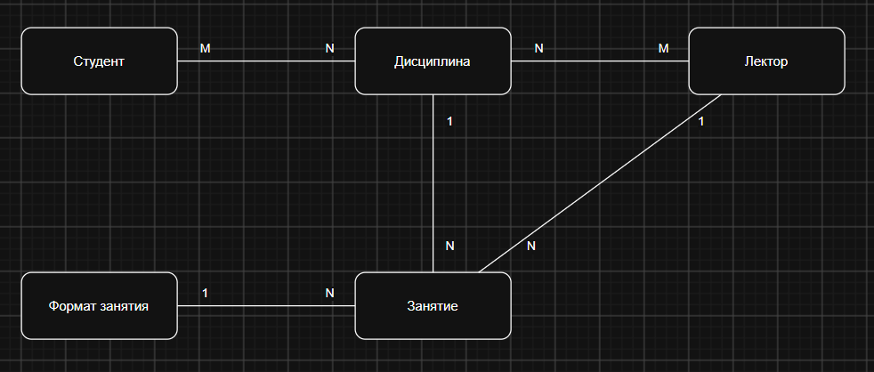
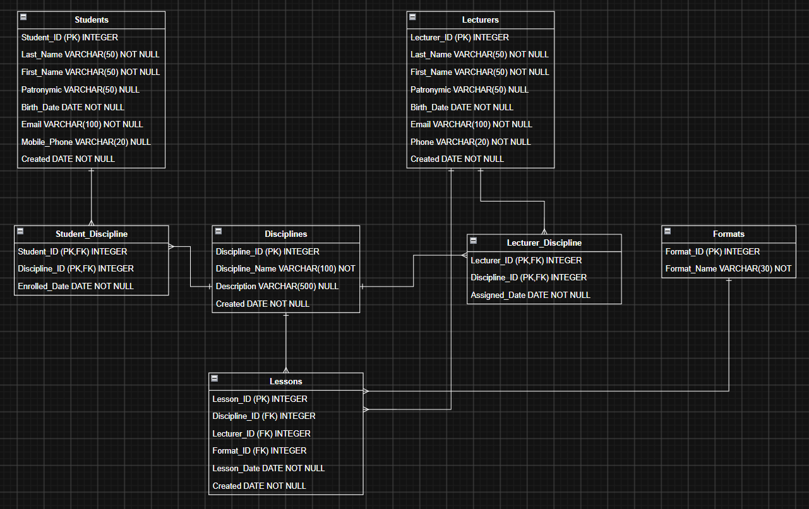

# Задание 3. Проектирование БД и SQL-запросы

## Оглавление

- [3.1 Модель данных РСУБД](#31-модель-данных-рсубд)
  - [Концептуальная модель данных Учебного центра](#концептуальная-модель-данных-учебного-центра)
    - [Процесс обучения и сущности БД](#процесс-обучения-и-сущности-бд)
    - [Сущности](#сущности)
    - [Связи между сущностями](#связи-между-сущностями)
    - [Особенности модели](#особенности-модели)
    - [Допущения](#допущения)
    - [ER-диаграмма (концептуальный уровень)](#er-диаграмма-концептуальный-уровень)
  - [Логическая модель данных](#логическая-модель-данных)
    - [1. STUDENTS (Студенты)](#1-students-студенты)
    - [2. LECTURERS (Лекторы)](#2-lecturers-лекторы)
    - [3. DISCIPLINES (Дисциплины)](#3-disciplines-дисциплины)
    - [4. FORMATS (Форматы проведения занятий)](#4-formats-форматы-проведения-занятий)
    - [5. STUDENT_DISCIPLINE (Связь Студент — Дисциплина)](#5-student_discipline-связь-студент--дисциплина)
    - [6. LECTURER_DISCIPLINE (Связь Лектор — Дисциплина)](#6-lecturer_discipline-связь-лектор--дисциплина)
    - [7. LESSONS (Занятия / Расписание)](#7-lessons-занятия--расписание)
    - [Связи между сущностями](#связи-между-сущностями-1)
    - [ER-диаграмма (логический уровень)](#er-диаграмма-логический-уровень)
- [3.2 Ответы на вопросы](#32-ответы-на-вопросы)
  - [1. В каком виде правильно хранить информацию о соотношении дисциплин, студентов и лекторов?](#1-в-каком-виде-правильно-хранить-информацию-о-соотношении-дисциплин-студентов-и-лекторов)
  - [2. Приведение к какой нормальной форме должно использоваться?](#2-приведение-к-какой-нормальной-форме-должно-использоваться)
- [3.3 SQL-запросы](#33-sql-запросы)
  - [Запрос 1. Дисциплины, к которым прикреплено больше 5 студентов](#запрос-1-дисциплины-к-которым-прикреплено-больше-5-студентов)
  - [Запрос 2. Средний возраст лекторов по «Системному анализу»](#запрос-2-средний-возраст-лекторов-по-системному-анализу)
  - [Запрос 3. Студенты без мобильного телефона](#запрос-3-студенты-без-мобильного-телефона)
  - [Запрос 4. Рейтинг популярности дисциплин](#запрос-4-рейтинг-популярности-дисциплин)
  - [Запрос 5. Онлайн-занятия по «Системному анализу» за текущий месяц](#запрос-5-онлайн-занятия-по-системному-анализу-за-текущий-месяц)

---

## 3.1 Модель данных РСУБД
### Концептуальная модель данных Учебного центра

#### Процесс обучения и сущности БД

В Учебном центре студенты проходят обучение по различным дисциплинам. Занятия по дисциплинам ведут лекторы. Каждое занятие проводится в определённом формате (онлайн или оффлайн) и в определённую дату. Студент может быть записан на несколько дисциплин, а на одну дисциплину может быть зачислено много студентов. Аналогично лектор может вести несколько дисциплин, и одну дисциплину могут вести несколько лекторов. Чтобы хранить эту информацию в БД, выделяются следующие сущности: студент, лектор, дисциплина, занятие и формат занятия.

#### Сущности

| Сущность        | Описание                                                              |
| --------------- | --------------------------------------------------------------------- |
| Студент         | Человек, который проходит обучение в Учебном центре                   |
| Лектор          | Преподаватель, который ведёт занятия по дисциплинам                   |
| Дисциплина      | Учебный предмет, например «Системный анализ»                          |
| Занятие         | Конкретная учебная встреча по дисциплине, проводимая в определённую дату |
| Формат занятия  | Способ проведения занятия: онлайн или оффлайн                         |

#### Связи между сущностями

| Связь                        | Тип   | Пояснение                                                                                              |
| ---------------------------- | ----- | ------------------------------------------------------------------------------------------------------ |
| Студент — Дисциплина         | M : N | Студент может посещать несколько дисциплин, на одной дисциплине обучаются много студентов              |
| Лектор — Дисциплина          | M : N | Лектор может вести несколько дисциплин, одну дисциплину могут вести несколько лекторов                 |
| Дисциплина — Занятие         | 1 : N | По одной дисциплине проводится много занятий, каждое занятие относится к одной дисциплине              |
| Лектор — Занятие             | 1 : N | Один лектор проводит много занятий, каждое занятие проводит один лектор                                |
| Формат занятия — Занятие     | 1 : N | Один формат используется на многих занятиях, у каждого занятия один формат                             |

#### Особенности модели

- Связи «многие ко многим» (M:N) на концептуальном уровне показаны напрямую. На логическом уровне они раскрываются через связующие таблицы `student_discipline` и `lecturer_discipline`.
- Формат занятия выделен в отдельную сущность (справочник), чтобы значения «Онлайн» и «Оффлайн» не дублировались в каждом занятии.
- Занятие связывает дисциплину, лектора и формат и фиксирует дату проведения, поэтому оно является центральной сущностью расписания.

#### Допущения

- Один студент может посещать несколько дисциплин.
- Один лектор может вести несколько дисциплин.
- Каждое занятие проводится по одной дисциплине, одним лектором и в одном формате.

#### ER-диаграмма (концептуальный уровень)



### Логическая модель данных

#### 1. STUDENTS (Студенты)

Хранит данные о студентах, поступивших на обучение.

| Атрибут      | Тип данных    | Обязательность | Ключ |
| ------------ | ------------- | -------------- | ---- |
| student_id   | INTEGER       | NOT NULL       | PK   |
| last_name    | VARCHAR(50)   | NOT NULL       |      |
| first_name   | VARCHAR(50)   | NOT NULL       |      |
| patronymic   | VARCHAR(50)   | NULL           |      |
| birth_date   | DATE          | NOT NULL       |      |
| email        | VARCHAR(100)  | NOT NULL       |      |
| mobile_phone | VARCHAR(20)   | NULL           |      |
| created      | DATE          | NOT NULL       |      |

#### 2. LECTURERS (Лекторы)

Хранит данные о преподавателях.

| Атрибут     | Тип данных   | Обязательность | Ключ |
| ----------- | ------------ | -------------- | ---- |
| lecturer_id | INTEGER      | NOT NULL       | PK   |
| last_name   | VARCHAR(50)  | NOT NULL       |      |
| first_name  | VARCHAR(50)  | NOT NULL       |      |
| patronymic  | VARCHAR(50)  | NULL           |      |
| birth_date  | DATE         | NOT NULL       |      |
| email       | VARCHAR(100) | NOT NULL       |      |
| phone       | VARCHAR(20)  | NOT NULL       |      |
| created     | DATE         | NOT NULL       |      |

#### 3. DISCIPLINES (Дисциплины)

Справочник учебных дисциплин.

| Атрибут         | Тип данных   | Обязательность | Ключ |
| --------------- | ------------ | -------------- | ---- |
| discipline_id   | INTEGER      | NOT NULL       | PK   |
| discipline_name | VARCHAR(100) | NOT NULL       |      |
| description     | VARCHAR(500) | NULL           |      |
| created         | DATE         | NOT NULL       |      |

#### 4. FORMATS (Форматы проведения занятий)

Справочник форматов (Онлайн, Оффлайн).

| Атрибут     | Тип данных  | Обязательность | Ключ |
| ----------- | ----------- | -------------- | ---- |
| format_id   | INTEGER     | NOT NULL       | PK   |
| format_name | VARCHAR(30) | NOT NULL       |      |

#### 5. STUDENT_DISCIPLINE (Связь Студент — Дисциплина)

Связующая таблица, реализующая отношение «многие ко многим»: один студент может быть прикреплён к нескольким дисциплинам, у одной дисциплины может быть много студентов.

| Атрибут       | Тип данных | Обязательность | Ключ                                |
| ------------- | ---------- | -------------- | ----------------------------------- |
| student_id    | INTEGER    | NOT NULL       | PK, FK → Students.student_id        |
| discipline_id | INTEGER    | NOT NULL       | PK, FK → Disciplines.discipline_id  |
| enrolled_date | DATE       | NOT NULL       |                                     |

Составной первичный ключ (`student_id` + `discipline_id`) гарантирует, что один студент не может быть прикреплён к одной и той же дисциплине дважды.

#### 6. LECTURER_DISCIPLINE (Связь Лектор — Дисциплина)

Связующая таблица: один лектор может вести несколько дисциплин, одну дисциплину может вести несколько лекторов.

| Атрибут       | Тип данных | Обязательность | Ключ                                |
| ------------- | ---------- | -------------- | ----------------------------------- |
| lecturer_id   | INTEGER    | NOT NULL       | PK, FK → Lecturers.lecturer_id      |
| discipline_id | INTEGER    | NOT NULL       | PK, FK → Disciplines.discipline_id  |
| assigned_date | DATE       | NOT NULL       |                                     |

#### 7. LESSONS (Занятия / Расписание)

Фиксирует факт проведения занятия (по какой дисциплине, с каким лектором, в каком формате и когда).

| Атрибут       | Тип данных | Обязательность | Ключ                                |
| ------------- | ---------- | -------------- | ----------------------------------- |
| lesson_id     | INTEGER    | NOT NULL       | PK                                  |
| discipline_id | INTEGER    | NOT NULL       | FK → Disciplines.discipline_id      |
| lecturer_id   | INTEGER    | NOT NULL       | FK → Lecturers.lecturer_id          |
| format_id     | INTEGER    | NOT NULL       | FK → Formats.format_id              |
| lesson_date   | DATE       | NOT NULL       |                                     |
| created       | DATE       | NOT NULL       |                                     |

#### Связи между сущностями

| Родительская таблица | Дочерняя таблица     | Тип   | Описание                                                    |
| -------------------- | -------------------- | ----- | ----------------------------------------------------------- |
| Students             | Student_Discipline   | 1 : N | Один студент может иметь много записей о зачислении на дисциплины |
| Disciplines          | Student_Discipline   | 1 : N | Одна дисциплина может иметь много прикреплённых студентов   |
| Lecturers            | Lecturer_Discipline  | 1 : N | Один лектор может вести много дисциплин                     |
| Disciplines          | Lecturer_Discipline  | 1 : N | Одну дисциплину может вести несколько лекторов              |
| Disciplines          | Lessons              | 1 : N | По одной дисциплине проводится много занятий                |
| Lecturers            | Lessons              | 1 : N | Один лектор проводит много занятий                          |
| Formats              | Lessons              | 1 : N | Один формат используется на многих занятиях                 |

Через `Student_Discipline` и `Lecturer_Discipline` на логическом уровне реализованы связи «многие ко многим»:

- **Students — Disciplines (M:N)** — студент изучает несколько дисциплин, дисциплину изучают несколько студентов;
- **Lecturers — Disciplines (M:N)** — лектор ведёт несколько дисциплин, дисциплину ведут несколько лекторов.

#### ER-диаграмма (логический уровень)



---

## 3.2 Ответы на вопросы

### 1. В каком виде правильно хранить информацию о соотношении дисциплин, студентов и лекторов?

В виде отдельных связующих таблиц **`student_discipline`** и **`lecturer_discipline`**, где одна строка соответствует одной связи («студент записан на дисциплину», «лектор ведёт дисциплину»). Первичный ключ в них составной из двух внешних ключей, поэтому одна и та же связь не может появиться дважды.

Это нужно потому, что студент изучает много дисциплин, а на дисциплине учится много студентов (связь «многие ко многим»), и реляционная БД не умеет хранить такую связь напрямую.

**Пример.**

Неправильно (список в одной ячейке):

| student_id | ФИО       | дисциплины            |
| ---------- | --------- | --------------------- |
| 1          | Иванов И. | Системный анализ, SQL |

Правильно (одна строка = одна связь):

| student_id | discipline_id         |
| ---------- | --------------------- |
| 1          | 10 (Системный анализ) |
| 1          | 11 (SQL)              |

### 2. Приведение к какой нормальной форме должно использоваться?

К третьей нормальной форме (3NF). Это значит, что в каждой ячейке хранится одно значение (1NF), каждое поле описывает запись целиком (2NF) и неключевое поле не зависит от другого неключевого поля (3NF). В результате каждый факт хранится в одном месте. Например, название формата «Онлайн» лежит в справочнике `formats`, а в таблице `lessons` стоит только ссылка `format_id`, поэтому при переименовании формата достаточно изменить одну запись.

---

## 3.3 SQL-запросы

### Запрос 1. Дисциплины, к которым прикреплено больше 5 студентов

```sql
SELECT
    disciplines.discipline_name AS Дисциплина,
    COUNT(student_discipline.student_id) AS Кол-во студентов
FROM disciplines
JOIN student_discipline ON student_discipline.discipline_id = disciplines.discipline_id
GROUP BY disciplines.discipline_name
HAVING COUNT(student_discipline.student_id) > 5;
```

### Запрос 2. Средний возраст лекторов по «Системному анализу»

```sql
SELECT
    ROUND(AVG(TIMESTAMPDIFF(YEAR, lecturers.birth_date, CURRENT_DATE))) AS Средний возраст
FROM lecturers
JOIN lecturer_discipline ON lecturer_discipline.lecturer_id = lecturers.lecturer_id
JOIN disciplines ON disciplines.discipline_id = lecturer_discipline.discipline_id
WHERE disciplines.discipline_name = 'Системный анализ';
```

### Запрос 3. Студенты без мобильного телефона

```sql
SELECT
    CONCAT_WS(' ', students.last_name, students.first_name, students.patronymic) AS `ФИО`
FROM students
WHERE students.mobile_phone IS NULL;
```

### Запрос 4. Рейтинг популярности дисциплин

```sql
SELECT
    (SELECT COUNT(*) + 1
     FROM (SELECT COUNT(*) AS students_count
           FROM student_discipline
           GROUP BY discipline_id) AS other
     WHERE other.students_count > rating.students_count) AS `Место в рейтинге`,
    rating.discipline_name AS Дисциплина,
    rating.students_count AS `Кол-во студентов`
FROM (SELECT disciplines.discipline_name AS discipline_name,
             COUNT(student_discipline.student_id) AS students_count
      FROM disciplines
      JOIN student_discipline ON student_discipline.discipline_id = disciplines.discipline_id
      GROUP BY disciplines.discipline_name) AS rating
ORDER BY `Место в рейтинге`;
```

### Запрос 5. Онлайн-занятия по «Системному анализу» за текущий месяц

```sql
SELECT
    disciplines.discipline_name AS `Название дисциплины`,
    lessons.lesson_date AS `Дата проведения занятия`,
    formats.format_name AS `Название формата`
FROM lessons
JOIN disciplines ON disciplines.discipline_id = lessons.discipline_id
JOIN formats ON formats.format_id = lessons.format_id
WHERE disciplines.discipline_name = 'Системный анализ'
  AND formats.format_name = 'Онлайн'
  AND YEAR(lessons.lesson_date) = YEAR(CURRENT_DATE)
  AND MONTH(lessons.lesson_date) = MONTH(CURRENT_DATE)
  AND lessons.lesson_date <= CURRENT_DATE;
```